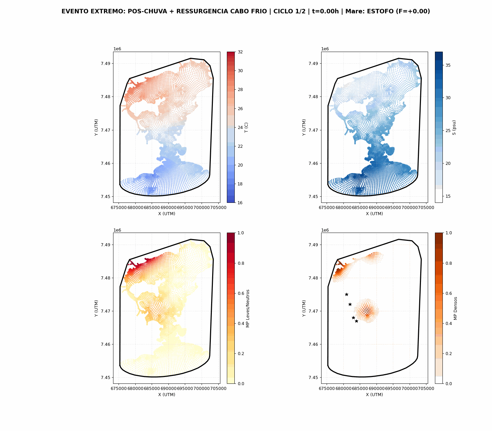

# 🌊 Simulação de Transporte de Microplásticos na Baía de Guanabara sob Evento Extremo

**Autor:** André Ribeiro de Rezende  
**Instituição:** Pesquisador Independente  
**Ano:** 2026  

---

## 🎬 Visualização da Simulação (2 Ciclos de Maré)

Este repositório apresenta uma simulação computacional do transporte e dispersão de microplásticos na Baía de Guanabara (RJ) e zona costeira adjacente sob condições de evento extremo: **pós-chuva intensa** combinada com **ressurgência de Cabo Frio**. 

A animação abaixo mostra a evolução hidrodinâmica e o transporte de poluentes ao longo de 24,84 horas (2 ciclos de maré semi-diurna completos).



### 📊 Legenda dos Painéis:
1. **Temperatura (°C):** Destaque para a penetração da Água Central do Atlântico Sul (ACAS) com a isoterma de 19°C avançando durante a enchente.
2. **Salinidade (psu):** Dinâmica da cunha salina (36 psu) sobrepondo-se à água doce fluvial (15 psu).
3. **Microplásticos Leves/Neutros:** Partículas em superfície/coluna, com maior dispersão espacial, fortemente influenciadas por ventos de quadrante NE.
4. **Microplásticos Densos + Hotspots:** Partículas de fundo com baixa mobilidade, acumulando-se em regiões críticas de retenção (★).

---

## 🔬 Fundamentação Científica

A parametrização da simulação integra dados e conceitos extraídos de estudos recentes sobre a hidrodinâmica e poluição da região:

*   **Fontes e Flutuabilidade:** Consideração de 20 fontes pontuais (12 rios afluentes, 3 emissários submarinos e 5 canais urbanos) e 3 classes de flutuabilidade (leves, neutros e densos), conforme modelagem lagrangeana no SisBaHiA® (RODRIGUES et al., 2026).
*   **Concentrações e Hotspots:** Adoção das concentrações de referência para o Emissário de Ipanema (ESEI, 4,75 mg/L) e Icaraí (ESIca, 1,5 mg/L), coeficiente de absorção em praias ($c_A = 0,05$) e identificação dos 5 hotspots de acúmulo: Marina da Glória, Enseada de Botafogo, Canal do Mangue, Canal do Cunha e Praia do Diabo/Forte de Copacabana (ROSMAN et al., 2024).
*   **Ressurgência e Ventos:** Aplicação do Índice Térmico de Ressurgência (ITR), com ventos de quadrante NE ($u \approx 6,7$ m/s) forçando o bombeamento de Ekman e a subida da ACAS ($T \approx 18^\circ$C, $S \approx 36$ psu) até a Baía de Guanabara (CARVALHO et al., 2003).

---

## 🛠️ Como Reproduzir a Simulação

### Requisitos
*   Python 3.8+
*   Bibliotecas: `pandas`, `numpy`, `matplotlib`, `scipy`
*   Dados da malha de elementos finitos do SisBaHiA® (disponíveis na pasta `02_Malha_e_Geometria/`)

### Execução
```bash
# Tornar o script executável
chmod +x animacao_2ciclos_mare.py

# Executar a simulação (pode levar 1 a 3 minutos para renderizar o GIF)
python3 animacao_2ciclos_mare.py
